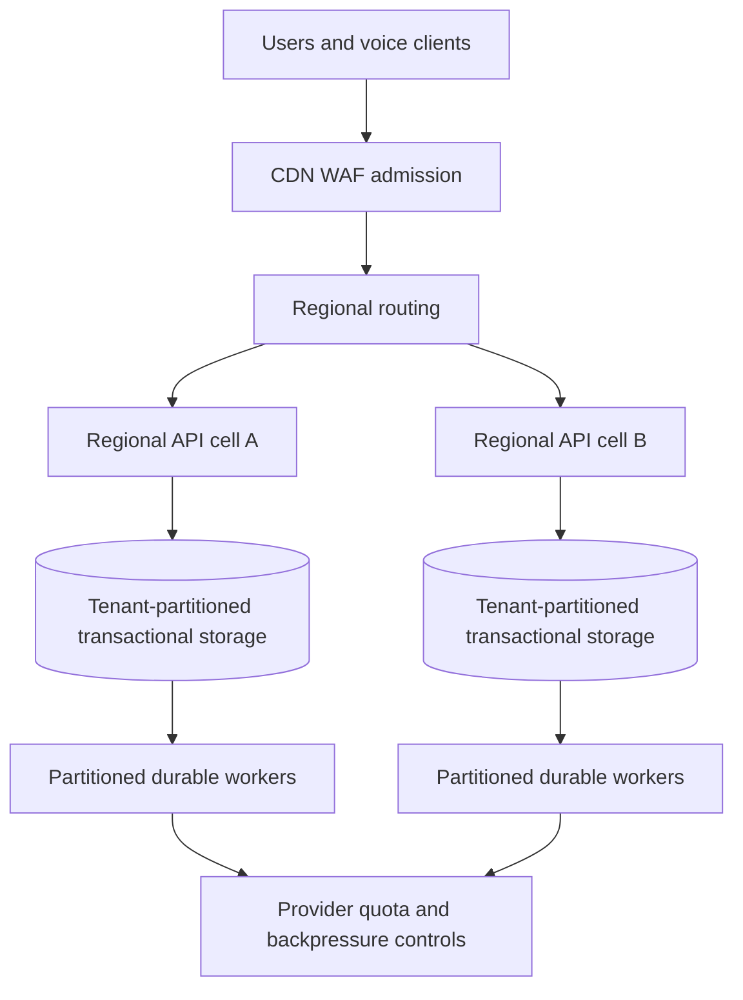

# Capacity roadmap: 1M+ concurrent users

This future target has staged capacity acceptance. The deployed single-business
release has not proved any million-scale workload. The distributed architecture
must be implemented and measured before increasing admission beyond a validated stage.

| Workload                   | Definition                                          | Measurements                                           |
| -------------------------- | --------------------------------------------------- | ------------------------------------------------------ |
| Registered accounts        | Stored identities and records                       | Data/index volume and restore time                     |
| Concurrent dashboard users | Active sessions and their read/write cadence        | Requests/sec, connections, p95/p99 and saturation      |
| Concurrent voice calls     | Native audio sessions using business tools          | Concurrency/start/tool quotas and acoustic performance |
| Mixed workload             | Declared session/call split and tenant distribution | Shared bottlenecks, fairness and delivery lag          |

One million sessions refreshing every thirty seconds imply roughly 33,333 requests/
second before writes. One million five-minute calls imply roughly 3,333 admissions/
second in steady state. With the current three-minute owner call cap, one million simultaneous calls at
full length imply roughly 5,556 admissions/second. These are sizing assumptions,
excluding bursts/reconnects/retries. Use `concurrency = arrival rate × average lifetime` with measured inputs.

## Current measured baseline

| Dimension             | Current verified scope (2026-10-25)                       | Target                                |
| --------------------- | --------------------------------------------------------- | ------------------------------------- |
| Deployment            | One shared server, five constrained services              | Regional cells with redundancy        |
| Voice concurrency     | One owner call at a time, 180-second cap, receipt-gated   | 1M+ simultaneous calls (V4)           |
| Dashboard sessions    | Single owner plus guarded local load criteria             | 1M+ active sessions (C4)              |
| Registered accounts   | Single business tenant with owner identity                | 1M+ stored accounts                   |
| Availability evidence | Point-in-time readiness and release parity                | 99% baseline, 99.9% production SLO    |

The gap between these columns is the work of stages C1–C4 and V1–V4; nothing in
the current column is extrapolated to the target column.

## Target topology

Separate failure domains and regional cells with explicit tenant placement. Keep
one consistency authority/writer per booking resource. Session routing, regional
failover and residency must agree. Add connection pooling, indexes, pagination,
bounded caches and read replicas only with defined consistency. Narrow tenant
locks only after concurrency regressions. A cache cannot confirm an uncommitted
booking or invent availability.

Workers need partitioning, fairness, backpressure, receipt reconciliation and
dead-letter handling. An external queue requires a transactional outbox and
idempotent consumption. Admission controls provider concurrency/start/tool quotas,
circuit breakers and bounded retry. Business HTTP capacity does not establish audio
or telephony capacity.

Kubernetes is optional orchestration, requiring resource requests, readiness,
disruption policies and measured scaling signals. Database/provider bottlenecks
remain outside pod autoscaling. See the official
[autoscaling guide](https://kubernetes.io/docs/concepts/workloads/autoscaling/).

## Stages

| Stage | Intended scope                                                      | Exit evidence                                                                        |
| ----- | ------------------------------------------------------------------- | ------------------------------------------------------------------------------------ |
| C0    | Guarded local baseline                                              | Environment/data, latency/errors, recovery and stop limits                           |
| C1    | 100–1,000 concurrent sessions                                       | Pagination, realistic cadence, pool/worker saturation                                |
| C2    | 10,000 concurrent sessions                                          | Multiple replicas, fairness, spike/soak and one-node loss                            |
| C3    | 100,000 concurrent sessions                                         | Partitions, database failover, quotas and headroom                                   |
| C4    | 1M+ active dashboard sessions                                       | Distributed generators, declared mixed workload, regional failure and sustained SLOs |
| V1–V4 | Increasing voice concurrency through a 1M+ simultaneous-call target | Written provider quotas, real audio acceptance and staged call tests                 |

These are planned gates, not hardware promises. Determine throughput/data size
before instance counts. Reserve measured headroom for a failed replica/cell and
account for tenant skew and retry amplification.

Stored-account growth needs its own index, migration, backup/restore and privacy
tests through one million registered accounts; it is not inferred from C4 session
traffic. Likewise, no backend load result can prove one million real calls without
account-specific telephony, provider, speech, model and business-tool commitments.
The mixed stage must exercise those workloads together rather than add separate
peak numbers. Record provider limits, region and data-location constraints, rates,
cost envelopes and failover assumptions before admitting traffic.

## Safe tests and deliverables

Most tests use local controlled transports/isolated databases. Ramp gradually;
cap duration, concurrency and data growth; stop at configured CPU/memory/pool/error/
latency limits. Measure generator saturation separately. Heavy tests must not slow
shared live services or affect other projects.

Run baseline/ramp/spike/soak/recovery/failover against exact releases/configuration.
Check duplicates and normal-user latency during load. Live voice requires approved
costs/quotas and the smallest useful sample. High native traffic cannot be assumed
free or inferred from HTTP tests.

Each stage delivers workload/data profiles, latency/resource charts, provider
quota evidence, cost envelope, saturation diagnosis, failure drills and an admission
ceiling. See [load criteria](core-load-spec.md), [reliability](../reliability.md)
and [build-plan gates](../../BUILD-PLAN.md).

## Workload model and admission decision

For each stage record active/idle session ratio, refresh/read/write cadence,
connection lifetime, payload/export/knowledge sizes, appointment contention,
provider tool calls per conversation, geographic distribution, tenant skew and
retry/reconnect bursts. One million stored accounts does not imply one million
active sessions. Dashboard request capacity and provider audio capacity have
different bottlenecks and must be exercised together for a mixed-stage claim.

Derive request arrival and connection counts from the declared workload. Measure
p50/p95/p99 latency, errors/timeouts, throughput, pool waits, lock time, backlog
age, resource saturation and correctness. Measure the load generator separately.
A stage exits only when thresholds set before the run pass across the sustained
window, burst/recovery and declared failure case, with headroom for loss of one
replica or cell. Preserve evidence for the worst tenant/resource skew.

## Regional data and failure strategy

Choose tenant placement and residency before sharding. Define one consistency
writer per booking resource, safe regional routing, credential/session authority,
provider region and replication/backup locations. Rehearse zone/cell loss, pool
exhaustion, unavailable providers, slow storage and mass reconnects. Verify that
failover does not duplicate appointments or external delivery. A regional routing
change cannot override customer data-location or transfer decisions.

## Economics and capacity commitments

Keep measured infrastructure, storage/egress, provider concurrency/start/tool,
speech/model, telephony and operational-support costs in a stage-specific envelope.
Include retries, idle capacity and recovery headroom; record pricing date and
written account-specific limits. Obtain authorization before chargeable tests or
resources. No instance count, provider quota or budget is promised by this design.

Stage deliverables include architecture/configuration revision, workload generator
and data volume, threshold specification, latency/resource distributions, failure
receipts, saturation diagnosis, cost assumptions, independent review and approved
admission ceiling. Review [monitoring](../monitoring.md),
[security](../security-model.md) and [legal data-location decisions](../legal-and-privacy.md)
with each capacity expansion.
